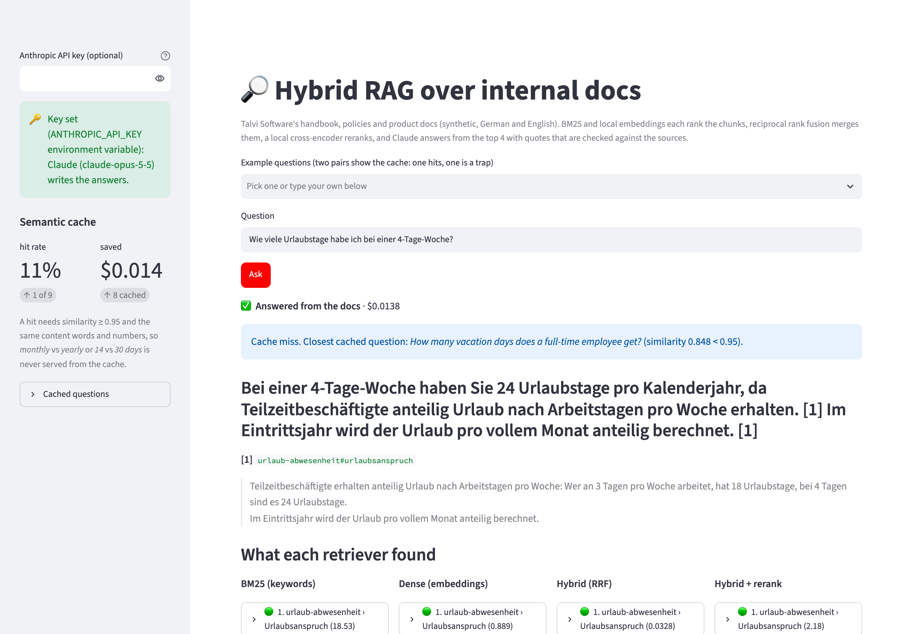
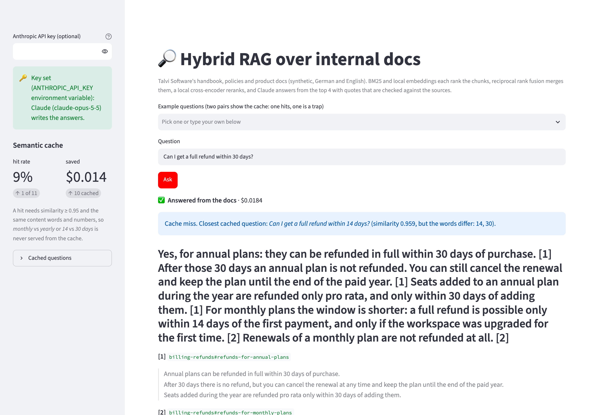
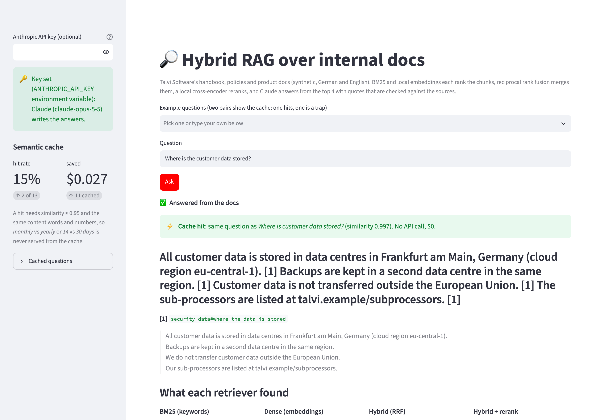
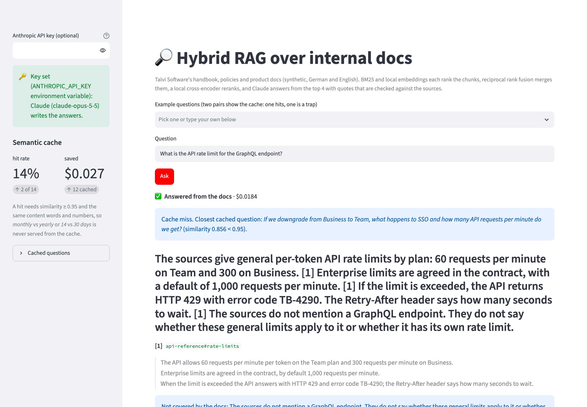

# hybrid-rag

Ask a company's **internal docs** questions in German or English and get an answer **with quotes you can
check**. Two retrievers run side by side: **BM25** for exact words and codes, **local embeddings** for
meaning and for questions in the other language. **Reciprocal rank fusion** merges them, a **local
cross-encoder** reranks, and Claude answers from the top 4 chunks. Every quote is checked against its source:
a claim whose quote is not really there is dropped, and a claim with a number its quotes do not contain is
flagged. A **semantic cache** answers repeated questions for free, without falling for near-duplicates like
*refund within 14 days* vs *within 30 days*.

Everything except the answer runs on your machine: the docs, both models, the vectors (a numpy file) and the
cache. No vector database, no Docker.

An eval with 40 hand-labeled questions, 12 unanswerable ones and 26 cache pairs measures recall@k for each
retriever, answer correctness, citation precision, cache hits, false hits and cost.

## Preview

**A German question**: the answer cites its source, and the quote below it is checked word for word against
the chunk. Underneath, the top 5 of each retriever (🟢 = the chunks Claude saw):



**A cache trap**: *Can I get a full refund within 30 days?* after *…within 14 days?* scores 0.959 similarity,
above the 0.95 threshold. It is still a miss, because the numbers differ, and it gets its own answer:



**A cache hit**: the same question reworded is served from the cache, with no API call:



**A partial answer**: there is no GraphQL endpoint in the docs. Claude gives the general rate limits it found
and says what the docs do not cover:



## Run it locally (step by step)

You need **Python 3.10+**, **git** and about **2.5 GB** of free disk space (1.5 GB for PyTorch and the other
packages, 1 GB for the two models).

1. Get the code:
   ```bash
   git clone https://github.com/ExNNeph/hybrid-rag.git
   cd hybrid-rag
   ```
2. Create and activate a virtual environment, so nothing is installed system-wide:
   ```bash
   python3 -m venv .venv
   source .venv/bin/activate          # Windows: .venv\Scripts\activate
   ```
3. Install the project with the demo extras (this pulls PyTorch, a few minutes):
   ```bash
   pip install -e ".[demo]"
   ```
4. Start the demo:
   ```bash
   hybrid-rag demo
   ```
   Your browser opens **http://localhost:8501**. The first start downloads the two models from Hugging Face
   (about 1 GB, once) and embeds the 81 chunks; after that it starts in seconds.
5. Stop it with `Ctrl-C` in the terminal. Next time, only steps 2 (`source .venv/bin/activate`) and 4 are needed.

Things to try in the demo:
- Without a key, ask anything: you see what each of the four retrievers finds, and which 4 chunks Claude
  would get.
- Paste your Anthropic key in the sidebar and **press Enter**. Ask *Can I get my money back on a yearly
  subscription?*, then *…on a monthly subscription?*: the second is a cache miss with the reason, and gets
  its own answer (14 days, not 30).
- Ask *How many vacation days does a full-time employee get?*, then *How many days of vacation do full-time
  employees have?*: a cache hit, $0. The answer comes from a German document.
- Ask something the docs do not cover, like *How much is the Christmas bonus?*: *Not in the docs.*

## How it works

1. **Docs** (`src/hybrid_rag/docs/`): 13 synthetic documents of a small software company, Talvi Software
   GmbH. The product docs (plans, billing, SLA, security, API) and part of the handbook (travel, remote work,
   IT) are in English; HR (vacation, working time, benefits, joining and leaving) and a customer FAQ are in
   German. The near-duplicates are built in on purpose: 14-day refunds on monthly plans and 30 days on
   annual ones, Team vs Business limits, full-time vs part-time vacation, Germany vs London hotel caps.
2. **Chunking** (`index.py`): one chunk per `##` section, 81 chunks of 24 to 69 words, each indexed with its
   document and section title. The sections are self-contained, so splitting further would only cut
   sentences apart.
3. **BM25**: the hand-written index from my contract-red-flags repo, with German and English stop words and
   a crude suffix strip.
4. **Dense**: `intfloat/multilingual-e5-small` (local, 118M parameters) embeds chunks and questions. The
   vectors are cached in `~/.cache/hybrid-rag/` as a numpy file; with 81 chunks a matrix product is the
   whole search.
5. **Fusion**: reciprocal rank fusion of the top 20 of each (score = Σ 1 / (60 + rank)). It uses only ranks,
   so BM25 scores and cosine similarities never need a common scale.
6. **Rerank**: `cross-encoder/mmarco-mMiniLMv2-L12-H384-v1` (local, multilingual) scores each of the 20
   fused chunks together with the question; the top 4 go to Claude.
7. **Answer** (`answer.py`): Claude (`claude-opus-5-5`) returns **structured output**
   (`output_config.format` with a JSON schema): answerable, and a list of claims. A fact claim carries
   citations, each with a source id and a word-for-word quote. A gap claim says what the sources do not cover.
8. **Citation check**: a quote must be in the chunk it cites (ignoring case, whitespace and typographic
   quotes) and that chunk must be one Claude was given. A fact claim without such a quote is **dropped**. A
   claim with a number that is in neither its quotes nor the question is **flagged**. If no fact claim
   survives, the answer is *Not in the docs*.
9. **Semantic cache** (`cache.py`): the question's embedding finds the closest earlier question. It is a hit
   only if the similarity is at least 0.95 **and** both questions have the same content words and the same
   numbers (word order, stop words, inflection and punctuation may differ). Hits and $ saved are counted.
   The CLI keeps the cache in `~/.cache/hybrid-rag/answers.json`, and the demo keeps it in memory.

## Command line

```bash
hybrid-rag search "Can I work from my flat in Spain?"     # top 5 of each retriever, no key needed
hybrid-rag ask "Wie viele Urlaubstage habe ich bei 4 Tagen pro Woche?"   # needs ANTHROPIC_API_KEY
hybrid-rag ask "..." --no-cache                           # always call the API
hybrid-rag chunks                                         # all chunk ids
hybrid-rag demo                                           # web demo on http://localhost:8501
```

| Variable | Needed for |
|---|---|
| `ANTHROPIC_API_KEY` | `ask` and answers in the demo (without it you still see the retrieval) |
| `HYBRID_RAG_MODEL` | override the model (default `claude-opus-5-5`) |
| `HYBRID_RAG_EMBED_MODEL`, `HYBRID_RAG_RERANK_MODEL` | other local models (the `query:`/`passage:` prefixes are for e5 models) |
| `HYBRID_RAG_CACHE_DIR` | where the vectors and the CLI's cache go (default `~/.cache/hybrid-rag`) |

The request opts into the API's server-side refusal fallback (`fallbacks: "default"`).

## Evals

`evals/questions.json` holds the hand-labeled cases:

- **40 answerable questions**, each with its expected source chunk(s) and the facts the answer must contain.
  They come in five kinds: 8 **keyword** (error codes, form names, region names), 12 **paraphrase** (*Can I
  get my money back on a yearly subscription?*), 10 **German**, 6 **cross-language** (an English question
  about a German document or the other way round) and 4 **multi-hop** (two chunks needed).
- **12 unanswerable questions** close to the docs' topics (Christmas bonus, GraphQL rate limit, salary bands)
  that must get *Not in the docs*.
- **26 cache pairs**: 12 rewordings that should be served from the cache and 14 **near-duplicate traps** that
  must not be: 14 vs 30 days, monthly vs annual, TB-4031 vs TB-4030, Team vs Business, Vollzeit vs Teilzeit,
  Germany vs London, *in der Probezeit* vs *nach der Probezeit*, train vs flight, and more.

```bash
python evals/run_eval.py          # retrieval and cache run locally; answers need ANTHROPIC_API_KEY
pytest                            # unit tests + sanity checks on the labels, no models, no API calls
```

## Results

One run of `evals/run_eval.py` with `claude-opus-5-5` (effort medium); per-case output in `evals/results.json`.

### Retrieval: recall@k (share of the labeled chunks in the top k)

| retriever | recall@1 | recall@3 | recall@5 | keyword @3 | paraphrase @3 | German @3 | cross-language @3 | multi-hop @3 |
|---|---|---|---|---|---|---|---|---|
| BM25 | 0.66 | 0.72 | 0.79 | 1.00 | 0.62 | 1.00 | 0.17 | 0.62 |
| dense | 0.76 | 0.91 | 0.93 | 1.00 | 0.88 | 1.00 | 0.83 | 0.75 |
| hybrid (RRF) | 0.69 | 0.85 | 0.86 | 1.00 | 0.88 | 1.00 | 0.50 | 0.62 |
| **hybrid + rerank** | **0.79** | **0.94** | **0.95** | 1.00 | 0.88 | 1.00 | 0.83 | **1.00** |

- **The fusion alone made things worse than dense alone** (0.85 vs 0.91 at k=3). On cross-language questions
  BM25 finds nothing useful (0.17) but still pushes its wrong guesses into the fused list. The **reranker** is
  what makes hybrid pay off: it recovers the cross-language cases and gets every multi-hop pair into the top 3.
- **My keyword questions were too easy**: dense found all of them too. With 81 short chunks, an error code
  like TB-4031 sits in a chunk whose topic the embedding already matches. BM25's exact matching would matter
  more in a corpus with hundreds of similar error pages.

### Answers

| metric | result |
|---|---|
| answer correct (every labeled fact in the answer) | **38 / 40 (95%)** |
| unanswerable questions answered *Not in the docs* | **11 / 12** |
| quotes not found in the cited source | **0 / 100** |
| citation precision (verified citations pointing to a labeled chunk) | 88 / 97 (91%) |
| claims dropped / flagged / gap claims | 0 / 0 / 3 of 102 |
| cost | 52 calls, 71,256 input / 13,435 output tokens, **$0.55** (about 1 cent per question) |

- **Both wrong answers are retrieval misses**: Claude never saw the right chunk. For *What do we get back if
  Talvi Boards was down a lot last month?* the service-credits chunk ranked 11th after reranking. For *Is
  there a monthly subsidy for cycling to work?* the 25 euros sit in the Deutschlandticket chunk, which dense ranked 18th
  and BM25 not at all. In both cases Claude said that the chunks it saw did not cover it, instead of guessing.
- **The unanswerable miss** is *What is the API rate limit for the GraphQL endpoint?*: Claude gave the
  general rate limits and added that the docs do not mention GraphQL. That is an honest partial answer, but
  my label wanted a plain *Not in the docs*.
- **Citation precision undercounts**: the 9 citations outside the labels point to neighbouring chunks that
  also support the claim (the probation chunk for the notice period during probation, the leave-request chunk
  for the 3 days blocked at Christmas).
- **What the first run caught**: I first told Claude to state uncovered parts *without a citation*, and the
  checker then dropped exactly those statements as unsupported. Partial answers looked complete. Gap
  claims are now their own kind, are kept, and the numbers above are from the run after the fix.

### Semantic cache

| rule | rewordings served from cache | traps served from cache (false hits) |
|---|---|---|
| similarity ≥ 0.90 only | 11 / 12 | 13 / 14 |
| similarity ≥ 0.95 only | 11 / 12 | **8 / 14** |
| similarity ≥ 0.97 only | 10 / 12 | 1 / 14 |
| similarity ≥ 0.99 only | 7 / 12 | 1 / 14 |
| **similarity ≥ 0.95 + same words and numbers** (used) | **7 / 12** | **0 / 14** |

- **No similarity threshold separates the traps**: *Kündigungsfrist in der Probezeit* vs *nach der
  Probezeit* scores **0.993**, while a true rewording (*Is there a free trial?* vs *…free trial period?*)
  scores 0.957. Rewordings ranged from 0.897 to 0.999 and traps from 0.872 to 0.993. The embedding is good at
  "same topic", which is exactly what makes a trap a trap.
- **The lexical guard costs hits, not answers**: 5 of 12 rewordings miss because a content word differs
  (*cancel my plan* vs *end my subscription*, *API error* vs *error code*). Each miss costs one API call
  (about 1 cent); a false hit would serve a wrong answer.
- **$ saved**: the 7 hits saved $0.075 at the measured $0.0106 per answer. In the eval each pair is a fresh
  cache; in real use the hit rate depends on how often people repeat questions, which these pairs do not
  measure.

**What this does not show:** 13 synthetic documents and questions written by the same person who wrote the
docs (I knew the wording, which helps BM25), one run without variance, and a cache measured on pairs I
designed. Next steps: a larger corpus with real near-duplicate pages, questions written by someone else, and
repeated runs.

## Known limits

- The corpus is small (81 chunks); a matrix product is fine here, a real corpus needs an ANN index (FAISS).
- BM25 has no real stemmer and no compound splitting (*Urlaubstage* never matches *Urlaub*).
- The quote check proves a quote exists in the source, not that it supports the claim; the number check
  catches the most common mismatch (14 vs 30 days), not all of them.
- The cache's lexical guard has no synonyms, and it does not track the language: a German question and its
  English twin are two cache entries. It is not invalidated when the docs change.
- The first start downloads 1 GB of models. After that a full search (both retrievers, fusion, reranking 20
  chunks) takes about 0.3 seconds on an M-series MacBook CPU.

## License

MIT
